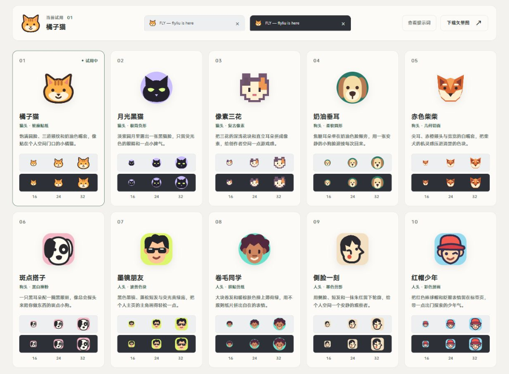

# 意外收获！fly-favicon开源！

2026-10-26 · [个人网站原文](https://flyliu.org/articles/fly-favicon-open-source)

一整天满课，本以为没什么时间坐在电脑前，但发现有3节都是实验课，这意味着我可以把笔记本带过去

于是一整个上午在完成了课上的任务后我就立马投入到个人网站的建设

在构思网站标签页图标的时候，我让CodeX反复给我生成icon，但始终没看到让我眼前一亮的结果，唯一让我觉得还可以的是一只小猫头的icon，可惜它长得太像Mac版Clash的图标，所以我放弃了它

我始终认为，如果一个人没什么创造力和想象力，那一定是他见过的东西太少，于是我开启了暴力抽卡模式

功夫不负有心人，我在一轮对话中获得了意外之喜，CodeX为我生成了一个本地预览的HTML，效果非常好，一眼看过去有那么两三个亮眼的设计，于是我立马决定，把这次对话制作成为一个可复用的skill

我使用skill-creator制作了fly-favicon的初版，我用它为我的个人网站探索了10种不同的favicon，结果第一版我就找到了满意的favicon

我觉得为网站设计一个亮眼的favicon，或者说logo，是一个说难也不难，说简单也不简单的事情，因为icon本身并不稀有，稀有的是独特的创意，这是一个小众但一定有人需要的需求！

所以，我把fly-favicon开源了！它能够让你的Agent为你探索适配你网站风格的favicon，并交付给你一个本地可视化HTML页面，点击对应的图标，网页上方的favicon也会跟着变化，让你能够直观地看到不同图标的效果

我本身很喜欢富有创意的设计，我很喜欢oil老师的作品，从他的个人站、作品集、各种skill你都能感受到他是一个很有品味和审美的人，我也经常模仿oil老师的设计，试图从中找寻一些灵感，但今天我居然自己做出了设计类的skill，这应该是今天最开心是事情了

今天还完成了许多项目README的重编排，以及自媒体工作台和个人站的UI探索

另外，我可能会制作一个管理本地默认应用的工具，因为平常在使用codex的时候，由于我是两个号，需要在两个浏览器的登录各自的账号，然后一遍一遍的设置默认浏览器，比较麻烦，反观电脑上其他的默认应用切换也比较麻烦，如某格式文件的默认打开方式，因此这个工具的作用就是集中可视化管理这些默认应用

今天就到这里，晚上要去健身房，回来继续开发，加油！
