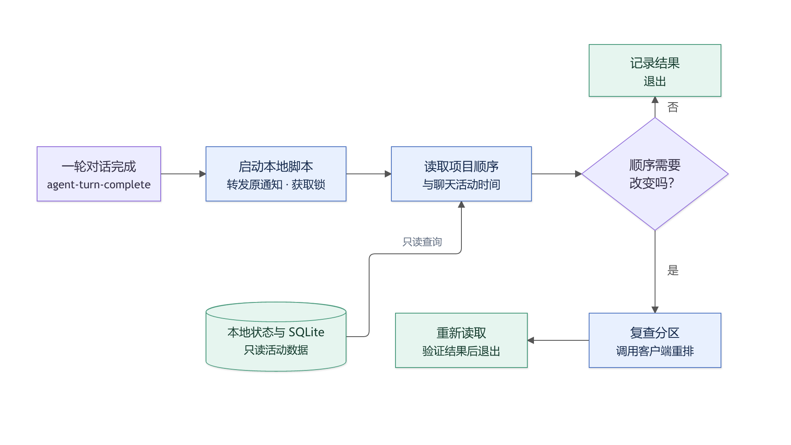
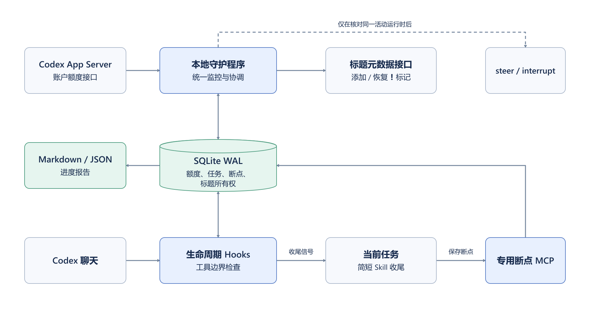

# 三个小项目同时在一天完成开源

2026-10-24 · [个人网站原文](https://flyliu.org/articles/three-open-source-projects-in-one-day)

昨天因为写开篇的缘故，没有实际记录我做了什么，等到今早我再回顾的时候已经忘掉了一些，我想昨天最开心的事情应该就是为我的小岛制作了一个很有设计感的官网，而且用的是代表的本人域名的子域名，island.flyliu.org，这个小岛是我三个月前设计的，没想到在GitHub斩获了200多star，我很意外，前几天我对它进行了一次大升级，把QQ微信和邮箱的消息都搬到了岛上，其次是我开始探索关于Personal Websites的制作，并且有了初版，剩余的时间都在学习

今早起来，我完成了对fly-CodexPulse的设计，在我日常使用Codex的时候，左侧任务栏的项目无法根据对话的时间顺序进行排序，这是一个很影响体验的‘小’痛点，于是我花费了一些时间与Codex探讨了实现的架构，原先Codex的建议是采用Hooks去通过每轮的对话实现检测，可这样有一个很大的弊端，若我在同一个项目持续对话，那么Hooks已经触发使得项目排在了前面，而后面产生的Hooks完全是Token和时间的浪费，于是我让Codex写了一个本地检测的脚本，在一轮对话完成后自动触发脚本去本地codex对话目录中判断时间排序是否发送变化，若发生了变化，才重新排序，架构设计如下：

代码部分的实现交给了codex，实测下来很稳定，现在终于能够舒舒服服的找到最近的项目了，另外，我也把他开源在了GitHub，地址：<https://github.com/flyl1u/fly-CodexPulse>

当然今天的任务并不止是这些，我还重测了之前的项目ReaFense，最近一段时间REA这个项目很火，它是一个能够让你的Agent轻松逆向某软件或是网页功能的项目，这就导致了大部分付费软件岌岌可危，我在几天前成功的参与了该项目部分bug的修复，是的，我的pr被合并了，我在想，既然最强的矛有了，那我是否能够利用这个矛去造出最坚固的盾呢

我的想法很简单，既然你可以逆向一切，那我就做一个项目，在构建完成之后使用REA来对构建产物进行逆向，并根据逆向的结果产出一份详尽的分析报告，并让Agent根据这份‘’漏洞报告‘’进行加固，Loop架构，只有当Agent加固至REA无法破解之时，才能跳出循环

说干就干，从前天到现在我几乎烧光了两个codex plus的额度，不断的在设计攻防战，直至今天早上，比较可惜的是，我还是无法抵挡REA的逆向，不过这并没有让我产生自我怀疑，我反倒觉得，REA真强啊，这个项目我打算先放一放了，眼下还有一些更重要的事情

其次是，今天上午还完成了fly-CodexLimit和fly-brief的大致开发，貌似今天做的有些多，事实上是因为这两个项目在此之前就开始了开发，在之前没有becoming的时候没有记录罢了

fly-CodexLimit是为了解决Codex额度不够导致任务半路中断，而用户也不知道任务具体执行到了哪一步的这个痛点，尤其是多任务并行的场景下，若是额度耗尽，就会出现多个任务一起毫无预兆的中断，于是我便思考，如何才能够让codex在额度快耗尽的时候，花费最少的Token让其自动在一个安全的存档点停下并汇报当前进度，用Hooks？如果是Hooks，他出现的时机应该是什么，如果使得Token的开销最小，经过多轮的思考以及和codex的对话，我们最终得出了一套较优的架构：
我来解释一下这个架构，首先，核心是‘本地守护程序’和‘本地数据库’，本地守护程序负责在后台读取账户额度，这不需要花费Token，从而避免了codex在任务中反复去读取额度，假设你设置剩余 5% 时开始暂，程序发现达到了这个条件，就在本地数据库上写入‘暂停信号’，而所有的任务都可以去读这个信号，Codex 工作时，会不断执行动作，比如读取文件、修改代码、运行命令等，Hooks就安排在这些动作前后执行，可以理解成：任务每走过一个安全的存档点，就看一眼告示板，当然，由于这个过程发生在本地，因此消耗不了多少时间和额度，当读取到暂停信号后，会触发一个简易的收尾skill，该skill的作用是为你留下这些：

> **任务：修改网站登录功能**\
> 已完成：登录页面和接口修改。\
> 当前状态：正在验证登录流程。\
> 未完成：异常情况测试。\
> 相关文件：登录页面、接口文件。\
> 下一步：检查测试输出，处理失败用例。

相当于保存现场，当额度恢复时，Codex 根据对话历史、文件和这份简易的报告继续，因此不用担心占据太多上下文

事实上中间还有一个步骤，在任务安全停下后，本地守护程序会在对话名前拼接一个红色感叹号"❗"，这是为了让你能够快速分辨哪些任务是没完成的，同样不消耗额度，总结来说，守护程序负责读取额度，知道什么时候该停，Hooks负责把消息送进去，Skill则负责停之前把事情交代清楚

除此之外，我还在调教我的fly-brief，初版已经打造的差不多了，不过细节有待优化，剩下的时间都在学习 好累\~
